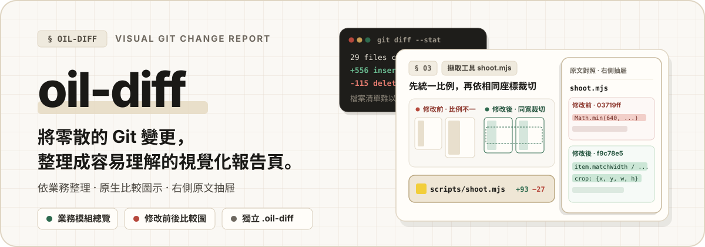
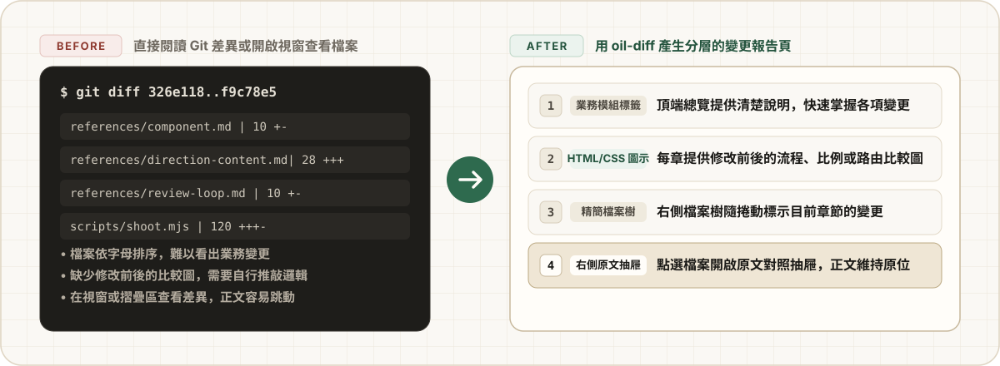
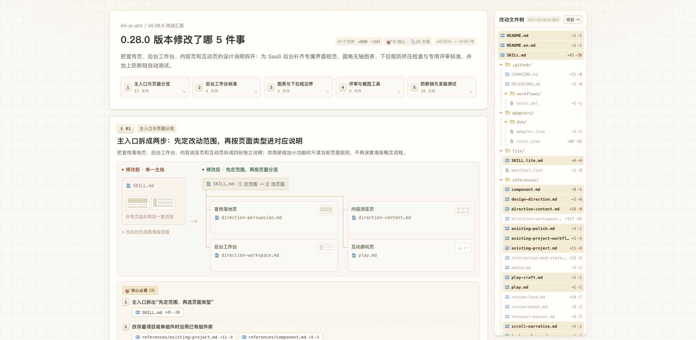
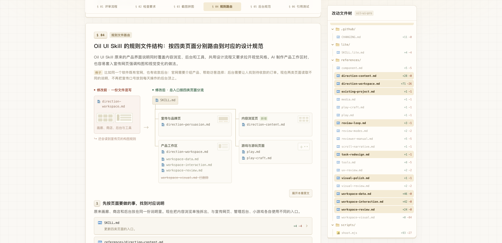
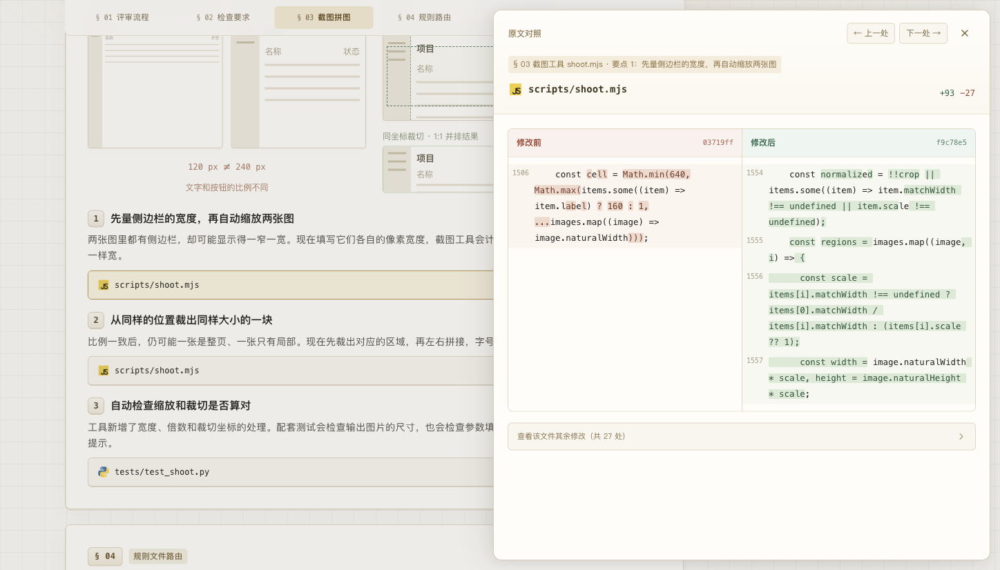

<p align="center">
  
</p>

`oil-diff` 是一个 **Git 改动可视化汇报 Skill**。它把工作区修改、某次提交或分支之间的 Git Diff，按业务目的整理成 **3～7 件具体的事**，自动生成一份一屏看懂的 HTML 汇报页（`.oil-diff/index.html`）。

无论是向团队汇报一轮改动、合并代码前自己通览全局，还是想快速搞懂 AI 刚才改了什么，都不需要按字母顺序挨个翻几十个源码文件——打开网页，30 秒就能看清改了哪几块业务、为什么改、核心要看哪几个文件。

<p align="center">
  
</p>

## 核心功能

<p align="center">
  
</p>

### 1. 一屏 Bento 看板，按业务讲人话

不再按文件列表罗列改动，而是把整批修改归纳成几张清晰的业务卡片：顶部先给出一行模块导航，每张卡片用平实的话讲清「原来有什么痛点、现在怎么解决」，拒绝空洞的技术黑话。

<p align="center">
  
</p>

### 2. 配图是配图，文字是文字

每一章都配有直观的前后对比图，不用大段文字凑数：
- **有界面改动时**：支持放入修改前后的真实运行截图，直接拖动滑杆对比或点击放大；
- **纯逻辑或规则改动时**：自动生成路由分流图、控件前后对比、流程变化或字段增删表，一眼看懂机制变化。

<p align="center">
  
</p>

### 3. 按具体改动分类「🎯 核心必看」与「📎 外围同步」

一次改动涉及几十个文件时，自动帮你分好轻重缓急：
- **🎯 核心必看**：直接归类挂在每章的 `1`、`2` 具体改动点下方，标明增删行数，告诉你 Review 时最该看哪几个文件；
- **📎 外围同步**：顺手同步修改的引用、配置或文档自动折叠收在卡片底部，不抢视线、也不漏文件。

### 4. 可收起文件树 + 右侧滑出代码抽屉

右侧配有紧凑的改动文件树（支持一键收起释放全宽画布）。想看某处具体改了哪几行代码时，点一下「核心必看」文件胶囊或右侧文件树，右侧立即滑出修改前后代码对照抽屉，主页面原地不动、不乱滚。

<p align="center">
  
</p>

## 安装与使用

<p align="center">
  
</p>

### 安装

**方式一 · 命令行安装**

```bash
npx skills add oil-oil/oil-diff
```

**方式二 · 直接发给 Agent 安装**

```text
请帮我安装这个 Skill：https://github.com/oil-oil/oil-diff
```

### 日常使用

安装后，直接在对话里告诉 Agent 你想看哪部分改动即可：

```text
用 oil-diff 把当前分支最近的改动做成汇报页。
```

```text
用 oil-diff 整理目前还没提交的修改，生成一份 HTML 改动汇报。
```

```text
用 oil-diff 对比 main..HEAD 的改动，看看这轮到底改了哪几件事。
```

## 适用边界、数据与运行环境

- **零污染仓库状态**：生成的网页与数据全部放在 `<repo>/.oil-diff/` 目录下，并自动对 Git 隐形，不修改项目原本的任何文件，也不影响 `git status`。
- **单文件离线可用**：最终生成的 `.oil-diff/index.html` 是零外部依赖的单文件网页，双击就能在浏览器打开，也可以直接发给同事查看。
- **配置与兼容性**：无需额外配置 API Key 或环境变量；仅依赖系统 `git` 与 Python 3.10+ 标准库，支持 macOS、Windows 与 Linux。

<p align="center">
  <a href="https://github.com/oil-oil/beautify-github-readme"></a>
</p>

## 许可证

MIT License
