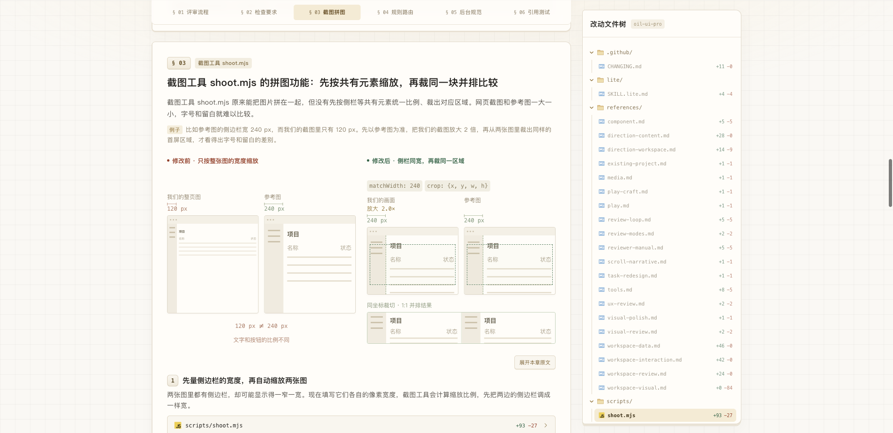
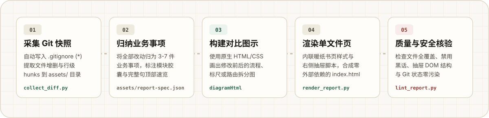

<p align="center">
  
</p>

`oil-diff` 是一个面向 AI Agent 与开发者的 **Git 改动可视化汇报 Skill**。它读取工作区修改、单次提交或多段分支范围，把按字母顺序散落的 Git Diff 归纳成 **3～7 件业务事项**，生成一份带 **业务模块速览、原生 HTML/CSS 前后对比舞台、单行改动文件树与右侧滑出式原文对照抽屉** 的单文件 HTML 汇报页（`.oil-diff/index.html`）。

无论是向项目负责人汇报一轮重构、给产品与设计伙伴解释底层改动，还是在合并分支前自己通览整批修改，读者都不需要逐个点开弹窗翻看原始代码行，30 秒就能看懂改了哪块业务、原来卡在哪里、现在怎么运作。

<p align="center">
  
</p>

<p align="center">
  
</p>

下面是一个真实项目的改动汇报案例：仓库跨越两段提交与一次中途文件删除，共涉及 **29 个文件路径（`+556 / −115` 行）**。如果直接看 `git diff`，20 多份规则文档、测试文件与截图脚本混在一起；通过 `oil-diff` 生成汇报页后，整批改动被清晰梳理为 **6 件独立业务事项**：

### 1. 首屏通览卡片与右侧单行文件树

打开页面首先看到暖纸网格背景上的总览卡：每件事都带有醒目的**业务模块胶囊**（如 `工作区评审`、`截图工具 shoot.mjs`、`规则文件路由`），并用一句完整的话写清具体动作与结果；右侧固定 `28px` 行高的改动文件树，随正文滚动自动高亮当前章节关联的文件。

<p align="center">
  
</p>

### 2. 原生 HTML/CSS 业务对比舞台

进入每一章后，不再用千篇一律的干瘪文字框，而是根据业务内容画出 `12px–13.5px` 的**原生 HTML/CSS + 微型矢量对比舞台**：

- **几何与工具类改动（如 `§ 03 截图工具 shoot.mjs`）**：直接画出带像素标尺（`120 px` vs `240 px`）、`2.0×` 放大倍率与绿色虚线取景框的对比工作台，一眼看懂「为什么原来整图缩放会导致字号比例失真，现在如何先按共有侧栏对齐宽度再裁切同一区域」。

<p align="center">
  
</p>

- **架构与目录拆分改动（如 `§ 04 规则文件路由`）**：左边画出旧版单文件混写多种页面说明的痛点，右边画出总入口按四类页面分流到独立文件的树状路由结构，并标出 `新增` 与 `已删除` 的文件节点。

<p align="center">
  
</p>

### 3. 点击滑出右侧原文对照抽屉（正文零跳动）

想核对某处具体改了哪几行代码时，点击章节内的文件条、右侧文件树或底部台账，页面右侧会平滑滑出 **原文对照抽屉（`aside.diff-drawer`）**：

- 左右并排展示「修改前 / 修改后」行号与字符级 `<mark>` 差异高亮；
- 顶部显示当前文件所属的章节与改法要点，支持 `← 上一处 / 下一处 →` 连续翻看或按 `Esc` 关闭；
- 切换不同文件时，左侧正文与可视化舞台保持原地不动，彻底告别传统手风琴展开导致的页面上下剧烈跳动。

<p align="center">
  
</p>

<p align="center">
  
</p>

`oil-diff` 在信息架构、文案表达与交互细节上内置了严格的标准：

| 层级 | 设计机制 | 解决什么问题 |
| --- | --- | --- |
| **第 1 层：首屏速览** | 顶部独立书页卡 + 业务模块胶囊 + 完整人话句子 + 滚动吸附章节栏 | 避免残缺的四字短语，让读者先建立全局目录，随时一键跳转任意章节 |
| **第 2 层：章节舞台** | 独立圆角暖纸卡（`22px` 间距）+ 痛点背景 + `例子` 场景条 + 原生 HTML/CSS 舞台 | 把作者自造缩写翻译成日常业务场景，用视觉布局代替大段文字解释 |
| **第 3 层：精简文件条** | 单文件要点自动隐藏重复说明；外围顺手修改的文档收进章节底部折叠汇总条 | 消除满屏重复的文件摘要和 10 多张同质化文件卡刷屏 |
| **第 4 层：右侧抽屉** | 滑出式 `aside.diff-drawer` + 字符级 `<mark>` 高亮 + 其余修改块按需展开 | 兼顾通览体验与逐行代码审计，左侧阅读视线永不丢失 |

针对不同类型的代码或文档改动，内置了 **6 类原生 HTML/CSS 可视化舞台模式**：

<p align="center">
  
</p>

<p align="center">
  
</p>

`oil-diff` 将确定性的 Git 数据提取、模板组装与静态审计交给 Python 标准库脚本，将业务归因、人话文案与舞台构图交给 Agent：

<p align="center">
  
</p>

- **零污染 `.oil-diff/` 资产隔离**：所有产物默认写入目标仓库下的 `.oil-diff/` 目录：
  - `.oil-diff/.gitignore`：第一步自动写入 `*`，借助 Git 原生子目录忽略机制让整个 `.oil-diff/` 对 Git 完全隐形，**不修改目标项目本身的 `.gitignore`**，`git status` 保持零变动；
  - `.oil-diff/index.html`：顶层只放最终交付的单文件汇报页（内联全部 CSS、脚本与数据，可单独发给他人离线打开）；
  - `.oil-diff/assets/`：专门收纳 `diff-data.json`、`report-spec.json` 与核验截图等中间资产，避免散乱文件污染项目或干扰查看。

<p align="center">
  
</p>

### 安装

**方式一 · 执行命令安装**

```bash
npx skills add oil-oil/oil-diff
```

**方式二 · 直接交给 Agent 安装**

```text
请帮我安装这个 Skill：https://github.com/oil-oil/oil-diff
```

### 在对话中直接触发

安装完成后，直接用自然语言告诉 Agent 你想汇报哪部分改动：

```text
用 oil-diff 把当前分支最近的改动做成可视化汇报页。
```

```text
用 oil-diff 梳理目前工作区还没提交的修改，生成一份给团队看的 HTML 改动汇报。
```

```text
用 oil-diff 对比 main..HEAD 的改动，按业务模块归因并配好前后对比图示。
```

### 命令行脚本按步调用

也可以在 Python 3.10+ 环境下直接调用内置脚本完成采集、渲染与静态校验：

```bash
# 1. 采集 Git 改动快照（自动创建 .oil-diff/.gitignore 与 .oil-diff/assets/）
python3 scripts/collect_diff.py --repo /path/to/repo --output /path/to/repo/.oil-diff

# 2. 根据业务归因规格（assets/report-spec.json）渲染自包含单文件 HTML
python3 scripts/render_report.py \
  --data /path/to/repo/.oil-diff/assets/diff-data.json \
  --spec /path/to/repo/.oil-diff/assets/report-spec.json \
  --output /path/to/repo/.oil-diff/index.html

# 3. 校验文件覆盖率、禁用词、单文件摘要去重、右侧抽屉结构与 Git 零污染边界
python3 scripts/lint_report.py --repo /path/to/repo --report-dir /path/to/repo/.oil-diff
```

### 配置与依赖兼容性

- **零额外配置**：无需配置 API Key、外部服务或环境变量，装好即可直接使用；默认输出目录为目标仓库下的 `.oil-diff/`，也可通过 `--output` 参数自定义路径。
- **依赖与跨平台兼容**：采集、渲染与校验脚本仅依赖 **Python 3.10+ 标准库** 与系统 `git` 命令，无需安装第三方包；生成的 `index.html` 为零外部依赖的单文件网页，兼容 macOS、Windows 与 Linux 上的现代桌面及移动浏览器。

### 规范与内部文档

- [SKILL.md](./SKILL.md)：完整工作流指令、模式选择与仓库安全底线
- [references/copywriting-and-structure.md](./references/copywriting-and-structure.md)：业务归因方法、文案防黑话规范与 `report-spec.json` 结构定义
- [references/visual-and-interaction.md](./references/visual-and-interaction.md)：暖纸网格书页视觉系统、6 类 HTML/CSS 舞台模式与右侧抽屉交互规范

<p align="center">
  <a href="https://github.com/oil-oil/beautify-github-readme"></a>
</p>

## 许可证

MIT License
